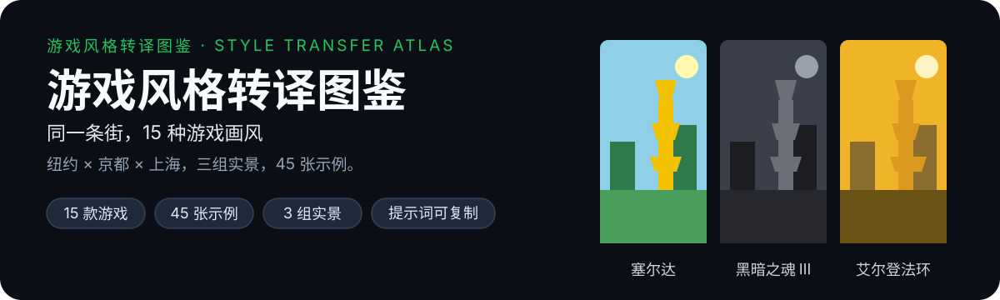
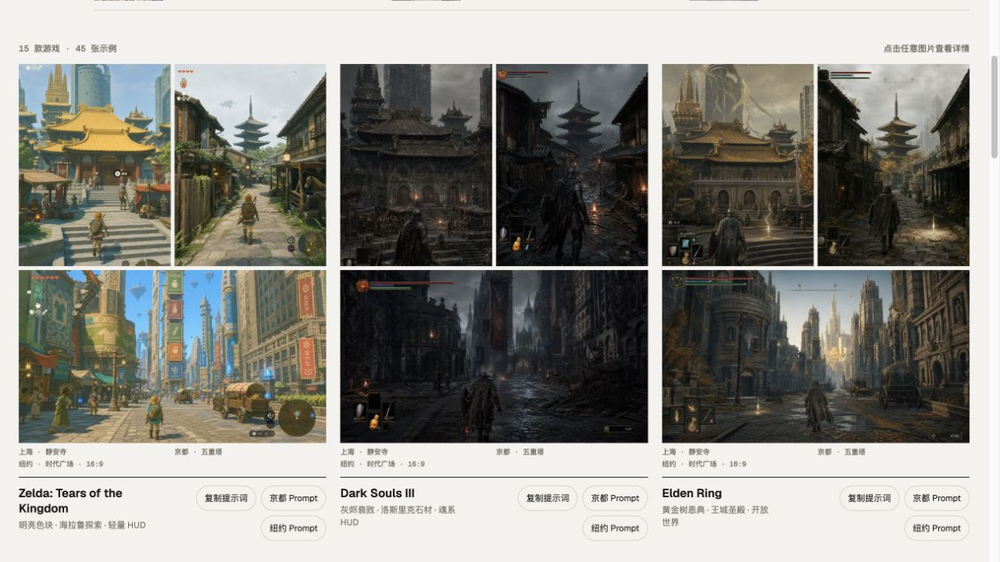

<p align="right">
  <a href="./README.md">简体中文</a> · <strong>English</strong>
</p>

<p align="center">
  
</p>

<p align="center">
  <a href="https://game-style-transfer-atlas.xiaosang.cc/"><strong>🌐 Live Demo (Primary)</strong></a> · 
  <a href="https://holynova.github.io/game-style-transfer-atlas/"><strong>🚀 Mirror (GitHub Pages)</strong></a> · 
  <a href="https://github.com/holynova/game-style-transfer-atlas"><strong>📦 GitHub Source</strong></a> · 
  <a href="https://xiaosang.cc/"><strong>✨ Portfolio</strong></a>
</p>

---

## Proof of Work

<p align="center">
  
</p>

---

## What It Is

Inspired by console HUD viewports and concept game art. Translates three real-world city photo sets (Times Square, Kyoto old streets, Shanghai Jing'an Temple) into the distinct visual styles of 15 video games including Cyberpunk 2077, Zelda: Tears of the Kingdom, Elden Ring, GTA V, and Minecraft.

---

## Why It Matters (Key Features)

- **Three aspect ratios, true to source**: Times Square 16:9 landscape, Kyoto 4:5 portrait, Jing'an Temple 9:16 portrait.
- **Real-World Photo Benchmark Comparison**: The detail view places the source photo next to the transfer result, showing material, lighting, and atmosphere shifts.
- **Skill Structure Notes**: Each style ships with a shared 6-step skill structure (input anchors, world translation, render language, gameplay camera, HUD constraints, negative constraints) explaining how the prompt is organized.
- **Extracted Turnkey Prompt Recipes**: Full prompt text for each game style, ready to copy and reuse.

---

## Inventory & Scope

15 game visual styles (Cyberpunk 2077, Zelda: Tears of the Kingdom, Elden Ring, GTA V, Minecraft, etc.), 3 photo locations (Jing'an 9:16, Kyoto 4:5, Times Square 16:9), detail lightbox.

---

## Quick Start

### 1. Live Demos
Experience it directly in your browser without any setup:
- 🌐 **Primary Demo**: [https://game-style-transfer-atlas.xiaosang.cc/](https://game-style-transfer-atlas.xiaosang.cc/)
- 🚀 **Alternative Mirror (GitHub Pages)**: [https://holynova.github.io/game-style-transfer-atlas/](https://holynova.github.io/game-style-transfer-atlas/)

### 2. Local Development
Clone the repository and launch locally:

```bash
git clone https://github.com/holynova/game-style-transfer-atlas.git
cd game-style-transfer-atlas
npm install && npm run dev
```

---

## License & Author

- **Author**: [holynova (Xiaosang)](https://xiaosang.cc/)
- **License**: [MIT License](./LICENSE)
- **Featured Collection**: Curated as part of [Where Craft Lives (xiaosang.cc)](https://xiaosang.cc/).
